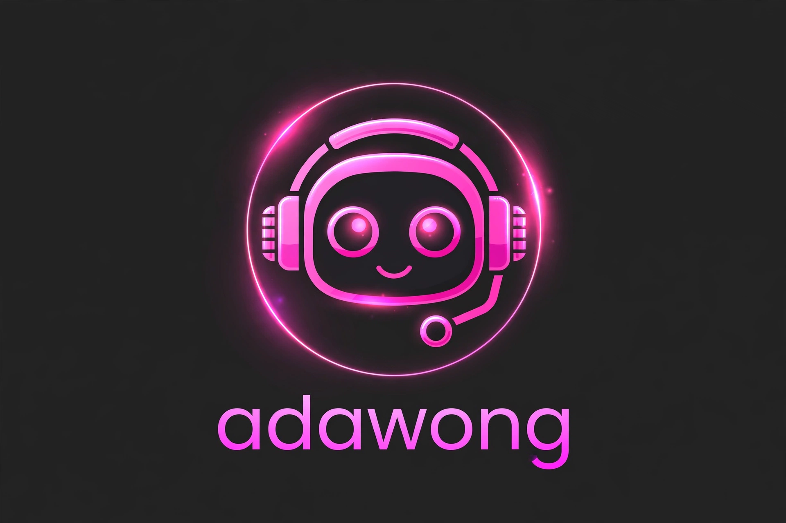

<p align="center">
  
</p>

<h1 align="center">readsw</h1>

<p align="center">
  <strong>WhatsApp 自托管机器人 — 状态自动化、媒体下载与多克隆运行器</strong>
</p>

<p align="center">
  Node.js &nbsp;|&nbsp; Baileys &nbsp;|&nbsp; 插件架构 &nbsp;|&nbsp; 仅限机主访问
</p>

<p align="center">
  <a href="README.md">English (US)</a> &nbsp;|&nbsp; <a href="README.id.md">Bahasa Indonesia</a> &nbsp;|&nbsp; <a href="README.ja.md">日本語</a> &nbsp;|&nbsp; <strong>中文</strong> &nbsp;|&nbsp; <a href="README.ru.md">Русский</a>
</p>

---

## 概述

**readsw** 是一个使用 Node.js 与 Baileys 库构建的个人 WhatsApp 自托管机器人。
它以单机主助手的形式运行，专注于三个方向：WhatsApp 状态（动态）的全面自动化、
高质量媒体下载，以及多克隆运行器——让多个附加号码能够基于同一套代码运行。

本机器人采用模块化插件系统——每个功能都是一个独立的插件文件，启动时自动加载。
当前版本包含 **69 个插件和 156 条命令**。

## 核心功能

### 状态（动态）自动化
- 自动已读收到的状态，并发送已读回执。
- 自动回应状态：可配置的文字序列、按联系人定制的文字，或随机表情池。
- **群组状态支持** — 检测发布到 WhatsApp 群组的状态，并以相同的自动已读与自动回应流程处理，普通群聊则完全不受影响。
- 状态保存器 — 收到的状态媒体会被本地归档。
- 可配置消息的状态自动回复。
- 每日状态摘要于 23:59（WIB）发送至 Telegram。

### 隐私与安全网
- 防删除 — 被删除的消息和状态会连同发送者、号码、时间和内容一并转发至 Telegram。
- 防阅后即焚 — 一次性查看的照片和视频会转发至 Telegram，以便再次打开。
- 防群组模式 — 机器人在群聊中完全静默（命令与自动功能均不响应）。
- 严格前缀策略 — 命令仅在使用 `.` 前缀时有效，普通词语按普通消息处理。

### 媒体下载
- **TikTok HD 1080p** — 通过 `.tiktokhd` 下载真正的 1080p 画质；在聊天中直接发送 TikTok 链接（无需任何命令）时也会自动下载。
- TikTok 图文帖子以单个相册形式发送。
- 带交互选择的 YouTube 音频/视频下载（回复 `1` 为 MP3，`2` 为 MP4）。
- 贴纸制作、Pinterest 与 Pixiv 图片搜索等。

### 多克隆（Jadibot）
- 可使用配对码将附加 WhatsApp 号码配对为克隆（`.jadibot <号码>`）。
- 所有克隆在独立的运行器进程中运行，共享同一套代码与插件；代码更新在运行器重启后应用于全部克隆。
- 自动检测并恢复失效的会话锁。

### 助手功能
- 仅限机主的 AI 聊天模式，回复快速、无延迟（`.adawong`）。
- 从 TikTok 链接队列定时发布状态。
- 动画加载面板与条理清晰的状态控制面板（`.sw`）。

## 技术栈

| 组件 | 技术 |
| --- | --- |
| 运行时 | Node.js（ES Modules） |
| WhatsApp API | Baileys |
| 架构 | 带自动加载器的插件系统 |
| 存储 | JSON 文件数据库（原子写入，防损坏） |
| 进程 | 带自动重启与连接看门狗的监督脚本 |
| 集成 | Telegram Bot API（转发与每日摘要） |

## 项目结构

```
readsw/
├── run.sh                  # 监督脚本（自动重启）
├── clone-run.sh            # 克隆运行器监督脚本
├── src/
│   ├── index.js            # 主机器人启动入口
│   ├── clone-runner.js     # 多克隆运行器
│   ├── handler/            # 消息与事件处理器
│   ├── helper/             # 共享辅助模块（状态、下载、会话、加载）
│   ├── plugins/            # 功能插件（自动加载）
│   └── db/                 # JSON 数据库层
└── assets/                 # 菜单横幅与标志
```

## 安装

```bash
git clone https://github.com/iyannsysu/bot-auto-read.git
cd bot-auto-read
npm install
cp .env.example .env   # 填写您的配置
bash run.sh
```

首次运行时，机器人会打印一个配对码。在手机上打开 WhatsApp，
进入 **已关联的设备**，输入该代码即可连接。

## 配置

主要设置通过 `.env` 提供：

| 变量 | 说明 |
| --- | --- |
| `BOT_NUMBER_OWNER` | 机主号码，以逗号分隔 |
| `BOT_PREFIX` | 命令前缀（默认 `.`） |
| `BOT_ALLOWED_NO_PREFIX` | 是否允许无前缀命令（默认 `false`） |
| `TELEGRAM_TOKEN` | 用于转发的 Telegram 机器人令牌（可选） |
| `TELEGRAM_CHAT_ID` | 转发的 Telegram 目标聊天（可选） |

状态功能的运行时开关（自动已读、自动回应、自动回复、随机表情模式、回应文字）
可通过 `.sw` 面板在聊天中实时管理，并保存在 `swconfig.json` 中——修改无需重启即可生效。

## 使用示例

| 命令 | 说明 |
| --- | --- |
| `.menu` | 显示命令菜单 |
| `.sw` | 状态控制面板（自动已读、自动回应、自动回复） |
| `.tiktokhd <链接>` | 以 HD 1080p 下载 TikTok 视频 |
| `.tt <链接>` | 下载 TikTok 视频或图文 |
| `.play <标题>` | 搜索 YouTube，然后回复 `1`（MP3）或 `2`（MP4） |
| `.jadibot <号码>` | 配对一个新的克隆号码 |
| `.status` | 显示主机器人与克隆的状态 |
| `.adawong on` | 在当前聊天启用 AI 聊天模式 |

无需命令也可以：直接发送 TikTok 链接，机器人会自动检测并回复高清视频。

## 说明

- 这是供您在自己账户上个人使用的自托管机器人。WhatsApp 并未官方支持非官方
  自动化；请负责任地使用，风险自担。
- 会话、`.env`、下载内容与日志有意不包含在此仓库中。

## 作者

由 **Iyan** 创建和维护 — [github.com/iyannsysu](https://github.com/iyannsysu)

## 许可证

本项目采用 MIT License 授权——详见 [LICENSE](LICENSE) 文件。

Copyright (c) 2025 Iyan
